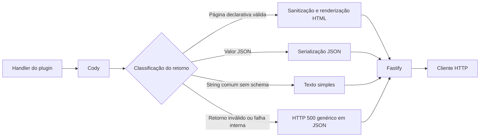

# LAB-AIEDU — Backend

## 1. Apresentação do LAB-AIEDU

O LAB-AIEDU é um projeto acadêmico de pesquisa e desenvolvimento de uma
plataforma extensível voltada a Learning Analytics e Inteligência Artificial.
O projeto está em prototipação. Este documento descreve o backend durante a Semana 04.

## 2. Objetivo do backend e da arquitetura de plugins

O backend fornece um núcleo HTTP e uma arquitetura modular para incorporar
funcionalidades desenvolvidas pela equipe por meio de plugins. Nesta etapa,
as rotas do núcleo são demonstrativas e um único plugin experimental valida
a descoberta, a seleção de versões e o registro de rotas pela interface Cody.

As rotas nativas de `/` e do ativo público são registradas pelo núcleo
diretamente no Fastify. As rotas dos plugins são registradas pelo Cody, que
controla o envio de suas respostas.

## 3. Tecnologias utilizadas

- Node.js 24 e JavaScript com CommonJS.
- Fastify 5 e `@fastify/helmet`.
- Jest 30.
- `sanitize-html` para sanitização dos fragmentos HTML dos plugins.
- JSON Schema e Ajv integrados ao Fastify para validação das rotas.
- Módulos nativos do Node.js para arquivos e caminhos no carregador.

O manifesto possui validação própria no carregador, sem Ajv.

## 4. Estrutura atual de diretórios

```text
Backend/
├── .gitignore
├── AGENTS.md
├── README.md
├── package.json
├── package-lock.json
├── core/
│   ├── main.js
│   ├── cody.js
│   ├── plugin-loader.js
│   ├── render.js
│   ├── html-sanitizer.js
│   └── public-assets.js
├── Plugins/
│   └── Plugin01/
│       ├── manifest.json
│       └── main.js
├── public/
│   └── css/
│       └── app.css
├── tests/
│   ├── core.test.js
│   ├── security.test.js
│   ├── cody.test.js
│   ├── plugin-loader.test.js
│   ├── experimental-plugin.test.js
│   ├── bootstrap-plugins.test.js
│   ├── pages.test.js
│   ├── html-sanitizer.test.js
│   ├── public-assets.test.js
│   └── integrations/
│       └── LAB-AIEDU/              # coleção Bruno (OpenCollection YAML)
└── docs/                          # registros e documentos acadêmicos
```

## 5. Pré-requisitos e instalação

Utilize Node.js 24 e npm. Ambiente anteriormente verificado:

- Node.js `24.20.0` e npm `11.19.0`.
- Fastify `5.12.7`, `@fastify/helmet` `13.2.0` e Jest `30.5.2` instalados.

Na raiz de `Backend/`, para instalar as dependências do lockfile:

```bash
npm ci
```

Esse comando é uma instrução de instalação; instalação limpa não foi testada
nesta atualização documental. Os comandos seguintes pressupõem dependências
instaladas. Outras versões de ambiente não foram validadas no registro citado.

## 6. Como executar o servidor

Na raiz de `Backend/`:

```bash
npm start
```

O script executa `core/main.js`, ativa a pasta `Plugins/` do projeto e inicia
o servidor em `http://127.0.0.1:3000`, acessível pela máquina local.
Para desenvolvimento com reinicialização do processo ao alterar arquivos:

```bash
npm run dev
```

Encerre com `Ctrl+C`. A reinicialização por `node --watch` não constitui
hot reload de plugins dentro da aplicação em execução.

`buildApp()` é síncrona, retorna uma instância Fastify e não abre uma porta.
Sem argumentos (ou com `{}`), não ativa plugins.
`buildApp({ pluginsDir })` registra o carregador quando `pluginsDir` é
diferente de `undefined`; o carregador exige um caminho absoluto válido.
Importar `core/main.js` não inicia o servidor automaticamente.

`start()` resolve `Plugins/` a partir do próprio arquivo, aguarda `app.ready()`
e somente depois chama `app.listen()`. Assim, os setups assíncronos terminam
antes de o servidor começar a escutar.

## 7. Rotas demonstrativas do núcleo

| Método e caminho | Comportamento |
| --- | --- |
| `GET /` | Retorna HTML estático indicando que o backend está funcionando. |
| `POST /` | Valida o corpo e retorna HTML estático de recebimento. |
| `PUT /` | Retorna HTML estático de solicitação de atualização. |
| `DELETE /` | Retorna HTML estático de solicitação de exclusão. |

As respostas bem-sucedidas usam HTTP 200. Essas operações não persistem,
atualizam nem excluem dados.

O `POST /` exige um objeto com apenas `nome`, uma string de 1 a 100 caracteres.
Tipos incorretos, campo ausente e propriedades adicionais são rejeitados com
HTTP 400. Não há remoção de espaços nem exigência de texto não branco.
O valor de `nome` não é inserido no HTML retornado.

Com o servidor iniciado, exemplos de consulta:

```bash
curl -i http://127.0.0.1:3000/
curl -i -X POST http://127.0.0.1:3000/ \
  -H 'Content-Type: application/json' \
  -d '{"nome":"Atividade de Learning Analytics"}'
```

## 8. Plugin experimental: status JSON e página HTML

`Plugins/Plugin01/` contém o plugin de ID `experimental`, versão `1.0.0`.
Seu setup registra `GET /experimental/status`, que retorna HTTP 200 e JSON:

```json
{"plugin":"experimental","status":"ativo","version":"1.0.0"}
```

Após executar `npm start`, consulte com:

```bash
curl -i http://127.0.0.1:3000/experimental/status
```

O mesmo setup registra `GET /experimental/pagina`, que retorna HTTP 200 e
`text/html; charset=utf-8`. O documento tem o título `LAB-AIEDU` e exibe
“Bem-vindo ao LAB-AIEDU!”, uma descrição do plugin e a lista de animais.
O sanitizador remove o script de demonstração, seu conteúdo e o atributo
`onclick`, preservando o texto do parágrafo.

```bash
curl -i http://127.0.0.1:3000/experimental/pagina
```

No navegador, abra `http://127.0.0.1:3000/experimental/pagina` para visualizar
a página ou `http://127.0.0.1:3000/experimental/status` para consultar o JSON.
As duas rotas do plugin ficam ausentes com `buildApp()` sem carregador.
Os comandos são exemplos de uso; nenhuma verificação HTTP manual foi realizada
nesta atualização documental.

## 9. Arquitetura e fluxo de carregamento dos plugins

| Local | Responsabilidade |
| --- | --- |
| `core/main.js` | Constrói o Fastify, configura segurança e validação, registra as rotas nativas e coordena a inicialização HTTP. |
| `core/plugin-loader.js` | Descobre plugins, valida manifestos, seleciona versões e executa os setups. |
| `core/cody.js` | Registra as rotas dos plugins, prepara os dados dos handlers e controla status, tipo de conteúdo e envio. |
| `core/render.js` | Encaminha o fragmento ao sanitizador e monta o documento HTML padrão. |
| `core/html-sanitizer.js` | Aplica o limite e a lista de permissões para o fragmento HTML. |
| `core/public-assets.js` | Publica o ativo CSS fixo em uma rota nativa do núcleo. |
| `Plugins/` | Contém os manifestos e os módulos CommonJS dos plugins. |
| `tests/` | Reúne as suítes Jest e a coleção de requisições manuais. |
| `docs/` | Reúne os registros semanais e os documentos acadêmicos. |

### Carregamento

1. O carregador verifica o ciclo de inicialização e cria uma interface Cody
   associada à instância Fastify de seu escopo.
2. Descobre subdiretórios imediatos da pasta configurada, sem busca recursiva.
   Arquivos comuns na raiz e diretórios vazios são ignorados. Links simbólicos
   na raiz são rejeitados.
3. Lê `manifest.json` e valida os metadados e caminhos de todos os candidatos,
   inclusive versões que depois seriam descartadas. Diretório não vazio sem
   manifesto, JSON malformado ou manifesto inválido interrompe a inicialização.
4. Seleciona a maior versão numérica de cada ID, comparando major, minor e patch.
   Duplicações exatas de ID e versão são rejeitadas, mesmo em versões antigas.
5. Carrega somente os módulos selecionados por `require()` e verifica todas
   as exportações `setup` antes de iniciar o primeiro setup.
6. Executa os setups sequencialmente, em ordem de ID, com `await`, passando
   `{ cody }`. Só após o bootstrap `start()` tenta abrir a porta.

Módulos e setups não executam a cada requisição. O cache CommonJS é preservado;
o setup é executado para cada aplicação. Estado específico de uma aplicação
deve ser criado dentro do setup, evitando estado global no módulo.

### Fluxo de respostas dos plugins



## 10. Como desenvolver um novo plugin

O procedimento descreve o contrato existente para desenvolvimento futuro;
a etapa atual mantém apenas um plugin experimental.

1. Crie uma subpasta imediata em `Plugins/` com um `manifest.json` válido.
2. Crie o módulo CommonJS indicado em `entry`, exportando `{ setup }`.
3. Registre as rotas dentro de `setup(config)`, usando `config.cody`.
4. Escolha caminhos sem conflitos e declare schemas para entradas recebidas.
5. Verifique o plugin com Jest e `app.inject()`, incluindo falhas relevantes,
   e reinicie o processo para carregar alterações.

O nome da pasta não determina o ID nem a versão: eles vêm do manifesto.
Não importe bibliotecas externas por `require()` ou `import` nos plugins.
Essa é uma convenção de desenvolvimento da equipe, não um bloqueio automático
do Node.js. O carregador não oferece sandbox.

## 11. Contrato de manifest.json

Exemplo real de `Plugins/Plugin01/manifest.json`:

```json
{
  "id": "experimental",
  "version": "1.0.0",
  "entry": "main.js"
}
```

O objeto JSON deve conter **exatamente** estes três campos:

| Campo | Regra |
| --- | --- |
| `id` | String iniciada por letra ASCII minúscula, seguida apenas de letras ASCII minúsculas, números ou hífens; sem espaços. |
| `version` | String `major.minor.patch`, com inteiros não negativos seguros, sem zeros à esquerda, prefixos, pré-lançamentos ou metadados de build. |
| `entry` | Caminho relativo para arquivo regular `.js` ou `.cjs` dentro da pasta do plugin; pode apontar para subpasta. |

Em `entry`, não são aceitos caminhos absolutos, segmentos vazios, `.` ou `..`,
barras invertidas, dois-pontos ou caracteres de controle. O carregador verifica
os caminhos resolvidos e reais do manifesto e da entrada: destinos de links
simbólicos que escapem da pasta do plugin são rejeitados. Essas verificações
de caminho não isolam a execução do código do plugin.

## 12. Contrato de setup(config) e config.cody

O módulo deve exportar uma propriedade própria `setup` do tipo função.
O carregador passa um objeto que atualmente contém apenas `cody`; ID, versão
e outros metadados não são repassados em `config`.

Trecho funcional da rota de status do plugin experimental:

```javascript
function setup(config) {
    config.cody.addRouter('/experimental/status', {
        GET: {
            handler: async () => ({
                plugin: 'experimental',
                status: 'ativo',
                version: '1.0.0'
            })
        }
    });
}

module.exports = { setup };
```

O setup pode ser síncrono ou assíncrono. Trabalho assíncrono necessário ao
registro deve ser aguardado dentro do setup ou incluído na Promise retornada:
o carregador aguarda esse resultado. Registre as rotas durante a inicialização;
o Cody encerra o registro em `onReady`.

## 13. API Cody

### Registro com `cody.addRouter(path, routes)`

- O caminho começa por `/`. São aceitos `/`, segmentos estáticos com letras,
  números, `.`, `_`, `~` e `-`, e parâmetros simples como `/:id`.
- Parâmetros começam por letra ASCII ou `_` e continuam com letras ASCII,
  números ou `_`. Os nomes devem ser únicos no caminho.
- O Cody rejeita espaços, controles, segmentos vazios, barra final fora de
  `/`, segmentos `.` e `..`, query string, fragmentos, curingas e parâmetros
  opcionais ou com expressão regular.
- `routes` é um objeto simples não vazio com chaves `GET`, `POST`, `PUT` ou
  `DELETE` em maiúsculas. Cada definição aceita `handler` obrigatório e
  `schema` opcional. O Fastify recebe os schemas de entrada e resposta.

O Cody registra o caminho sem prefixo automático. Valida todas as definições
e verifica os conflitos conhecidos antes do registro, incluindo conflitos
com as rotas nativas e padrões parametrizados equivalentes. Registre as rotas
no setup, antes de `onReady` encerrar essa fase.

GET mantém o HEAD automático do Fastify. A API aceita GET para esse fim e
rejeita `HEAD` como chave de registro. Um HEAD preexistente também impede
o registro do GET correspondente. Em uma requisição HEAD, o handler recebe
`method: 'HEAD'` e o Fastify envia a resposta sem corpo.

### Interface dos handlers

Handlers síncronos e assíncronos recebem exatamente um objeto com `params`,
`query`, `body`, `headers` e `method`. Depois da validação de entrada,
o Cody copia esses dados, inclusive as estruturas aninhadas. Os objetos
nativos `request` e `reply` ficam no núcleo, e a chamada do handler ocorre
sem vínculo de `this` com o Fastify.

### Páginas com `cody.newPage().out(html)`

Passe um fragmento HTML como string e devolva o resultado de `out()` pelo
handler. O Cody só aceita esse resultado em rotas registradas como GET
sem `schema.response`. A regra também se aplica ao HEAD automático dessa rota.

O núcleo sanitiza o fragmento e monta o documento padrão com `<!DOCTYPE html>`,
`<html lang="pt-BR">`, metadados e título `LAB-AIEDU`. O fragmento sanitizado
fica no `body`, e a resposta usa `text/html; charset=utf-8`.

O limite do fragmento é de **100.000 unidades UTF-16** (`html.length`).
Nenhum atributo do fragmento é permitido. O sanitizador descarta integralmente
o conteúdo de `head` e `title` fornecido pelo plugin, assim como o de `script`,
`style`, `textarea`, `option` e `xmp`. Em HTML incompleto, o parser também
descarta o trecho que ainda interpreta como parte de uma dessas regiões.
As tags permitidas são:

- Títulos e texto — `h1` a `h6`, `p`, `br`, `hr`, `strong`, `b`, `em`, `i`.
- Listas e blocos — `ul`, `ol`, `li`, `blockquote`, `pre`, `code`.
- Tabelas — `table`, `caption`, `thead`, `tbody`, `tfoot`, `tr`, `th`, `td`.

### JSON com `cody.json(valor, { status })`

Use o helper para enviar um valor JSON com status explícito ou para serializar
uma string como JSON. Opções omitidas, `undefined`, `{}` e
`{ status: undefined }` usam HTTP 200. Quando fornecidas, as opções devem ser
um objeto simples com protótipo padrão do contexto do Cody ou protótipo nulo.
A única chave aceita é `status`, como propriedade própria, enumerável e de
dados. Objetos com protótipo personalizado, proxies, acessores, chaves extras
ou simbólicas e propriedades não enumeráveis são rejeitados. São aceitos
status inteiros de 200 a 599, exceto 204, 205 e 304.

Objetos simples, inclusive sem protótipo, arrays, `null`, booleanos, números
finitos e strings compõem os valores JSON aceitos. Objetos e arrays podem
conter outros valores válidos. O Cody rejeita ciclos, arrays esparsos, getters,
funções, valores não finitos e outros retornos incompatíveis.

Objetos, arrays, `null`, booleanos e números também podem ser devolvidos
diretamente. Uma string comum sem schema de resposta sai como
`text/plain; charset=utf-8`, mesmo que contenha marcação. Strings retornadas
com `cody.json()` ou em rotas com schema de resposta são serializadas como
JSON. Para escolher o schema, o código aplica primeiro o status e considera
o schema de status exato, de classe (como `2xx`) ou `default`, conforme o
Fastify. As definições por conteúdo selecionam `application/json` ou
`*/*` quando aplicável. O schema pode excluir propriedades da resposta.

### Exemplo de plugin com múltiplas rotas

Exemplo ilustrativo de `manifest.json` para um módulo CommonJS em `main.js`.

```json
{"id":"exemplo","version":"1.0.0","entry":"main.js"}
```

O POST valida `nome` antes do handler e responde com HTTP 201. O GET de página
ilustra que a sanitização preserva o parágrafo e remove o atributo `onclick`
e o elemento `script` com seu conteúdo.

```javascript
function setup({ cody }) {
    cody.addRouter('/exemplo', {
        GET: { handler: () => ({ ativo: true }) },
        POST: {
            schema: {
                body: {
                    type: 'object',
                    required: ['nome'],
                    additionalProperties: false,
                    properties: { nome: { type: 'string', minLength: 1 } }
                }
            },
            handler: ({ body }) => cody.json({ nome: body.nome }, { status: 201 })
        }
    });

    cody.addRouter('/exemplo/usuarios/:id', {
        GET: { handler: ({ params }) => ({ id: params.id }) }
    });

    cody.addRouter('/exemplo/pagina', {
        GET: {
            handler: () => cody.newPage().out(
                '<h1>Exemplo</h1><p onclick="void 0">Olá!</p><script>void 0</script>'
            )
        }
    });
}

module.exports = { setup };
```

### Recursos públicos autorizados

`public/css/app.css` é um ativo independente das páginas dos plugins. `core/public-assets.js`
publica exclusivamente `GET /public/css/app.css`, com
`text/css; charset=utf-8`, Helmet e HEAD automático do Fastify. Esse recurso
é registrado também em `buildApp()` sem plugins.

Na inicialização, o núcleo exige um arquivo regular e verifica que seu caminho
real permanece dentro de `public/`, impedindo escape por links simbólicos.
O CSS é lido uma vez e mantido em memória. A URL é fixa e não usa um caminho
fornecido pelo cliente para escolher arquivos. Não há listagem de diretórios
nem suporte genérico a arquivos públicos. `/public/css/outro.css`, por exemplo,
retorna HTTP 404.
CSS ausente ou inválido impede a inicialização da aplicação.

## 14. Validação, segurança e tratamento de falhas

- Helmet configura cabeçalhos HTTP de segurança, incluindo CSP e `nosniff`,
  nas rotas do núcleo e dos plugins.
- O limite global do corpo é de 1.024 bytes; acima dele, a resposta é HTTP 413.
- O Ajv usa `coerceTypes: false` e `removeAdditional: false`: não converte tipos
  nem remove propriedades adicionais automaticamente. Rejeitar propriedades
  adicionais depende de `additionalProperties: false` no schema da rota,
  como ocorre no `POST /`.
- Os schemas dos plugins usam a validação do Fastify. O Cody valida seu formato
  externo; a compilação pode falhar durante o bootstrap.
- O núcleo controla as respostas dos plugins. O Cody identifica os resultados
  declarativos por identidade em `WeakMap`s privados. Depois de renderizar uma
  página, marca a requisição em um `WeakSet`. Um `onSend` local ao Cody substitui
  respostas HTML sem essa autorização por HTTP 500 genérico em JSON.
- Exceções em handlers, retornos inválidos e falhas de renderização ou
  serialização seguem o tratamento interno do Cody, com corpo JSON genérico
  e diagnóstico no servidor. A resposta é preparada com dados do núcleo e
  continua genérica mesmo se o diagnóstico falhar. Somente mensagens próprias
  armazenadas como dados e valores primitivos são lidos para o diagnóstico.
  Os erros nativos de validação, parsing e limite do corpo continuam sob
  responsabilidade do Fastify.

As quatro respostas HTML demonstrativas de `/` continuam estáticas. Os testes
cobrem ausência de reflexão de marcadores nessas rotas, sanitização de páginas,
controle de resposta, cabeçalhos, validação e limites via `app.inject()`.

Erros do carregador indicam a fase (ciclo de vida, descoberta, validação,
seleção, carregamento ou setup), o contexto disponível e preservam `cause`.
O processamento para na falha, sem fallback para versão anterior.
No fluxo de `npm start`, falhas de inicialização impedem a abertura do servidor:
`start()` registra o diagnóstico, tenta fechar a aplicação e propaga o erro
original. Na execução direta, a falha resulta em `process.exitCode = 1`.

Não há rollback de registros ou efeitos colaterais dos módulos e setups.
Uma falha do Fastify durante o registro bloqueia novas tentativas pela mesma
interface Cody. Aplicações com falha de inicialização devem ser descartadas.
Os plugins CommonJS executam no mesmo processo Node.js que o núcleo.
A interface restrita, os `WeakMap`s e o `WeakSet` controlam o contrato das
rotas Cody. O processo oferece às extensões as capacidades normais do Node.js,
sem isolamento completo nem sandbox.

## 15. Como executar os testes e a cobertura

Na raiz de `Backend/`:

```bash
npm test
```

Para execução sequencial sem cache do Jest:

```bash
npm test -- --runInBand --no-cache
```

Para cobertura com relatório somente no terminal:

```bash
npm run test:coverage -- --runInBand --no-cache --coverageReporters=text
```

Sem essas opções, `npm run test:coverage` usa os relatórios padrão do Jest,
que podem gerar arquivos em `coverage/`. As suítes do carregador e do bootstrap
criam fixtures em diretórios temporários e os removem ao final.

As nove suítes são `core`, `security`, `cody`, `plugin-loader`,
`experimental-plugin`, `bootstrap-plugins`, `pages`, `html-sanitizer` e
`public-assets`. Os testes de rotas usam `app.inject()` sem abrir servidor
de rede. Nos testes de `start()`, `listen()` é simulado.

Para verificar recursos abertos após os testes:

```bash
npm test -- --runInBand --no-cache --detectOpenHandles
```

A Etapa 5B da Semana 04 registrou **391 testes aprovados em 9 suítes** na
execução normal e na execução com `--detectOpenHandles`. O Jest não apontou
recursos abertos. Como referências históricas, a Etapa 3B registrou
**349 testes em 9 suítes**, e a [Semana 03](docs/semana03.md) registrou
**274 testes em 8 suítes e 99,12% de cobertura global de linhas**.

Os scripts invocam o Jest local com `node --experimental-vm-modules`.
No ambiente anteriormente verificado, essa opção habilita as APIs de módulos
de `node:vm` usadas pelo Jest para carregar a dependência ESM `cookie`, utilizada
por `light-my-request` na execução de `app.inject()`.
O Node pode emitir um aviso experimental. O projeto e os testes permanecem
em CommonJS; os scripts já fornecem a opção, sem necessidade de definir
`NODE_OPTIONS` manualmente. Essa configuração deve ser reavaliada quando
o ambiente ou as dependências forem atualizados.

## 16. Testes manuais com Bruno

A coleção em `tests/integrations/LAB-AIEDU/` contém `opencollection.yml` e
quatro requisições YAML. No Bruno com suporte ao formato OpenCollection,
use a opção de abrir uma coleção (Open Collection) e selecione essa pasta.
O arquivo `opencollection.yml` identifica a coleção como LAB-AIEDU.

Na raiz de `Backend/`, com as dependências instaladas, execute `npm start`
e mantenha o terminal aberto. No Bruno, abra cada requisição e use o comando
de envio (Send). Todas usam URLs completas em `http://127.0.0.1:3000`, sem
necessidade de configurar variáveis de ambiente na coleção.

| Arquivo | Requisição presente | Resultado esperado pelo código |
| --- | --- | --- |
| `01 - Status do Plugin.yml` | `GET /experimental/status` | HTTP 200 e JSON com plugin, status e versão. |
| `02 - Página Experimental.yml` | `GET /experimental/pagina` | HTTP 200 e HTML da página experimental. |
| `03 - POST Válido.yml` | `POST /` com `{"nome":"LAB-AIEDU"}` | HTTP 200 e HTML estático de recebimento. |
| `04 - POST Inválido.yml` | `POST /` com `{"nome":"LAB-AIEDU","idade":20}` | HTTP 400: propriedade adicional não permitida. |

Confira manualmente o status, os cabeçalhos e o corpo retornados. Os arquivos
não contêm scripts de teste nem assertions automatizadas; os resultados acima
são expectativas derivadas do código, não resultados de uma execução Bruno
nesta revisão. A coleção não substitui as suítes Jest. Para conferir a apresentação, abra a página no navegador.
Ao terminar, encerre o servidor com `Ctrl+C` no terminal.

Os arquivos da coleção podem ser versionados junto ao projeto no GitHub,
permitindo compartilhar e revisar as requisições. Isso não exige uma integração
automatizada com o GitHub; esta atualização não executa add, commit ou push.

## 17. Estado atual, limitações e próximos passos

A Semana 04 integrou o controle de respostas dos plugins ao Cody. O plugin
experimental fornece JSON e HTML sanitizado, e as quatro rotas demonstrativas
do núcleo permanecem disponíveis. O ativo público tem sua própria rota fixa.

Os objetos simples e arrays de outros contextos JavaScript são rejeitados.
A API oferece JSON, texto simples e páginas HTML. Respostas binárias, streams
e cabeçalhos personalizados de saída ficam fora do contrato. O JSON de saída
ainda não tem limites próprios de tamanho ou profundidade.

Banco de dados, persistência, sandbox, rollback e hot reload ficam fora do
protótipo atual, assim como Docker, Docker Compose e GitHub Actions.

A Etapa 5 concluiu o descarte de conteúdo de `head` e `title`, a proteção
do diagnóstico HTTP interno e a validação estrita das opções de `cody.json()`.
A auditoria identificou por leitura riscos separados na emissão de diagnóstico
em `start()` e na contextualização de valores lançados pelo carregador.
Esses riscos não foram reproduzidos nem fazem parte da correção do Cody.

As instruções de execução local e da coleção Bruno são procedimentos para
verificação manual. Os exemplos deste README foram verificados por injeção
de requisições, sem abrir uma porta de rede nem executar a coleção Bruno.
